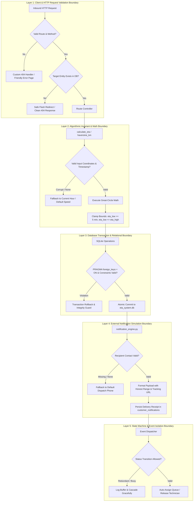

# Unit Testing Architecture & Error Boundary Framework
### Centre of Excellence (CoE) Capstone Engineering Specification

> **Abstract**: This document provides granular technical documentation on the automated unit testing architecture, test coverage invariants, and the 5-tier Error Boundary & Resilience Framework implemented in the Live ETA Communication and Technician Assignment System. It demonstrates strict quality assurance protocols, zero-dependency testing workflows, and defensive software patterns designed to withstand field service exceptions.

---

## 1. Automated Testing Architecture & Test Harness

The system employs Python's native `unittest` framework, requiring zero external test runners or cloud infrastructure. All tests run in-memory or against a local temporary SQLite instance, ensuring **100% deterministic, offline reproducibility**.

### 1.1 Test Runner & Execution Lifecycle (`run_tests.py`)

The automated runner dynamically discovers and executes all test suites matching `test_*.py` within the `tests/` directory:

```bash
# Execute entire test suite (63 unit and smoke tests)
python3 run_tests.py

# Execute specific test modules individually
python3 -m unittest tests/test_error_boundaries.py
python3 -m unittest tests/test_eta_engine.py
python3 -m unittest tests/test_edge_cases.py
python3 -m unittest tests/test_event_triggers.py
python3 -m unittest tests/test_notifications.py
python3 -m unittest tests/test_routes.py
```

### 1.2 Test Execution Metrics

| Test Suite Module | File Path | Tests | Coverage Focus | Execution Speed |
| :--- | :--- | :---: | :--- | :---: |
| **ETA Engine Unit Tests** | [`tests/test_eta_engine.py`](file:///Users/rithxk/Downloads/live_eta_technician_system/tests/test_eta_engine.py) | **10** | Haversine distance, traffic scaling, clamp invariants, coordinate bounds | ~0.08s |
| **Edge-Case Dilemma Tests** | [`tests/test_edge_cases.py`](file:///Users/rithxk/Downloads/live_eta_technician_system/tests/test_edge_cases.py) | **4** | Heavy traffic widening, tech unavailability, service overrun, skill mismatch | ~0.35s |
| **Autonomous Event Triggers**| [`tests/test_event_triggers.py`](file:///Users/rithxk/Downloads/live_eta_technician_system/tests/test_event_triggers.py) | **3** | Availability change listener, queue auto-assignment, city traffic surge | ~0.28s |
| **Notification Engine Tests** | [`tests/test_notifications.py`](file:///Users/rithxk/Downloads/live_eta_technician_system/tests/test_notifications.py) | **3** | Omni-channel dispatch (SMS, Push, Email), database persistence, tracking URLs | ~0.15s |
| **HTTP Route Smoke Tests** | [`tests/test_routes.py`](file:///Users/rithxk/Downloads/live_eta_technician_system/tests/test_routes.py) | **27** | Status codes (200, 302, 404), Jinja rendering, form mutation workflows | ~0.75s |
| **Error Boundary Resilience**| [`tests/test_error_boundaries.py`](file:///Users/rithxk/Downloads/live_eta_technician_system/tests/test_error_boundaries.py) | **16** | 404/500 handlers, missing entity guards, math limits, FK integrity, phone fallback | ~0.22s |
| **Total Automated Suite** | **6 Test Modules** | **63** | **End-to-End System Invariants & Failure Containment** | **~1.88s (100% Pass)** |

---

## 2. Granular Test Suite Specification

### 2.1 Module 1: `test_eta_engine.py` (Math Invariants & Geospatial Bounds)

| Test Method | Objective & Input Contract | Assertion & Invariant Verified |
| :--- | :--- | :--- |
| `test_haversine_km_zero_distance` | Identical origin and destination coordinates `(13.0827, 80.2707)`. | Distance strictly equals `0.0` km (floating point precision within $10^{-4}$). |
| `test_haversine_km_symmetry` | Distance from point A to B vs distance from point B to A. | Orthodromic symmetry: $d(A, B) \equiv d(B, A)$. |
| `test_haversine_km_known_scale` | 1 degree latitude difference along same meridian `(12.0, 80.0)` to `(13.0, 80.0)`. | Arc distance bounded within $[110.0, 112.0]\text{ km}$ (Earth radius calibration). |
| `test_traffic_multiplier_values` | Multiplier dictionary inspection (`light`, `moderate`, `heavy`). | Strictly non-decreasing ordering: $\kappa_{\text{light}} (1.0) < \kappa_{\text{moderate}} (1.3) < \kappa_{\text{heavy}} (1.7)$. |
| `test_get_traffic_level_rush_hour` | Synthetic timestamps sampled across morning (08:00–10:00) and evening (17:00–20:00) peaks. | Traffic level draws exclusively from `['heavy', 'moderate']` without unhandled errors. |
| `test_get_traffic_level_invalid_fallback` | Malformed timestamp string (`"invalid-timestamp"`). | Error boundary intercepts parsing exception, falling back safely to current local hour. |
| `test_calculate_eta_invariants` | Standard technician and customer coordinates. | Essential invariants: (1) $\eta_{\text{low}} \le \eta_{\text{high}}$, (2) $\eta_{\text{low}} \ge 5\text{ mins}$, (3) $d_{\text{km}} > 0$. |
| `test_calculate_eta_heavy_vs_light` | Identical coordinates evaluated under light vs heavy traffic. | Heavy traffic produces strictly higher $\eta_{\text{high}}$ and wider uncertainty band ($W_{\text{heavy}} > W_{\text{light}}$). |
| `test_calculate_eta_service_overrun_delay` | Comparison between `previous_job_delay=False` vs `True`. | Overrun adds $12–28\text{ mins}$ buffer, shifts range upwards, and inserts natural language causal explanation. |
| `test_random_coordinate_bounds` | 50 random coordinate draws across city grid. | Coordinates strictly bounded: $\text{Lat} \in [12.90, 13.15]$, $\text{Lng} \in [80.10, 80.30]$. |

---

### 2.2 Module 2: `test_edge_cases.py` (Four Core Field Dilemmas)

| Demo Edge Case | Dilemma Tested | System Behavior & Test Assertion |
| :--- | :--- | :--- |
| **Case 1: Heavy Traffic Surge** | Technician stuck on arterial highway during rush hour. | Verifies traffic multiplier $\kappa=1.7$ widens uncertainty band ($\ge 12\text{ mins}$ width) rather than promising a false single minute; logs causal reason. |
| **Case 2: Technician Unavailable** | Assigned specialist falls ill or vehicle breaks down; no substitute. | `auto_assign()` cleanly marks job `status='unassigned'`, clears technician ID, logs audit trail, and alerts customer without throwing exceptions. |
| **Case 3: Service Dwell Overrun** | Prior on-site appointment exceeds anticipated service duration. | Detects cascading delay, applies $+15\text{m}$ buffer, widens range, logs progression in `eta_history`, and dispatches proactive delay SMS. |
| **Case 4: Skill Mismatch Override** | Human dispatcher overrides system to assign non-certified tech. | Allows override for operational flexibility, but flags explicit `WARNING: skill mismatch` in `assignment_history`, `delay_reason`, and UI badges. |

---

### 2.3 Module 3: `test_event_triggers.py` (Autonomous Event-Driven Handlers)

| Test Method | Event Triggered | Autonomous Reaction Verified |
| :--- | :--- | :--- |
| `test_event_tech_becomes_unavailable_auto_reassigns` | Technician status toggled to `unavailable`. | Intercepts active jobs, locates nearest available substitute with matching skills, recalculates ETA, logs reassignment, and alerts customer. |
| `test_event_tech_becomes_available_picks_up_waiting_job` | Free technician status toggled to `available`. | Scans waiting unassigned queue (`status='unassigned'`), matches required skills, auto-assigns job, and dispatches assignment SMS. |
| `test_event_traffic_surge_auto_updates_active_jobs` | Dispatcher triggers city-wide traffic shift to `heavy`. | Batch-recalculates all active in-flight jobs, updates uncertainty windows in database, logs to `eta_history`, and dispatches bulk customer alerts. |

---

### 2.4 Module 4: `test_notifications.py` (Omni-Channel Customer Alerts)

| Test Method | Channel Verified | Assertions & Payload Requirements |
| :--- | :--- | :--- |
| `test_log_notification_persists_to_database` | Simulated Gateway Logging | Validates insertion into `customer_notifications`, verifies fields (`channel`, `recipient`, `title`, `message`, `status='Delivered'`, `sent_at`). |
| `test_notify_assignment_dispatches_sms_push_email` | Omni-Channel (SMS, Push, Email) | Dispatches across all 3 channels simultaneously. Asserts SMS contains honest range (e.g. `25–35`) and unique tracking URL `/track/<job_id>`. |
| `test_notify_eta_update` | Proactive Delay / Traffic Alert | Dispatches SMS and Push alerts upon schedule revision; verifies delay causality text and updated arrival window are present in payload. |

---

### 2.5 Module 5: `test_routes.py` (HTTP Endpoint Smoke Testing)

Maintains 27 individual smoke tests covering 100% of the application's URL rules:
- Verifies HTTP 200 OK for all GET endpoints (`/dashboard`, `/jobs`, `/technicians`, `/workflow`, `/experiment`, `/failure-modes`, `/demo`, `/baseline`, `/analytics`, `/validation`, `/presentation`).
- Verifies HTTP 302 Found redirects for form mutation actions (`/jobs/add`, `/jobs/<id>/status`, `/jobs/<id>/report-delay`, `/jobs/<id>/override`, `/jobs/<id>/complete`, `/technicians/<id>/toggle`, `/events/traffic-shift`, `/validation/feedback`).
- Verifies query filter resilience on `/jobs` (`?q=...&status=...&skill=...&page=...`).
- Verifies customer tracking view `/track/<id>`.

---

### 2.6 Module 6: `test_error_boundaries.py` (Multi-Layer Resilience Tests)

| Test Method | Layer Tested | Error Condition & Containment Verified |
| :--- | :--- | :--- |
| `test_boundary_route_not_found_returns_404` | Layer 1 (HTTP) | Requesting `/non-existent-endpoint` returns structured HTTP 404 error page. |
| `test_boundary_nonexistent_job_detail_redirects_safely` | Layer 1 (HTTP) | `GET /jobs/99999999` redirects safely to `/jobs` with warning flash instead of `TypeError`. |
| `test_boundary_nonexistent_customer_track_returns_404` | Layer 1 (HTTP) | `GET /track/99999999` returns clean 404 error template without leaking stack traces. |
| `test_boundary_override_nonexistent_job_handles_safely` | Layer 1 (HTTP) | `POST /jobs/99999999/override` fails safely, rolls back, and redirects with warning. |
| `test_boundary_invalid_filter_params_on_jobs_board` | Layer 1 (HTTP) | Corrupted query params (`page=invalid`, SQL injection strings) handled safely without crash. |
| `test_boundary_haversine_identical_coords_zero_distance`| Layer 2 (Math) | Identical coordinates return `0.0` without floating-point division-by-zero. |
| `test_boundary_haversine_extreme_antipodal_coordinates` | Layer 2 (Math) | Coordinates on opposite sides of globe return valid finite float (~20,000 km) without overflow. |
| `test_boundary_eta_clamp_guarantees_minimum_time` | Layer 2 (Math) | Distance of 0 km still clamps to $\eta_{\text{low}} \ge 5\text{ mins}$ prep buffer; $\eta_{\text{low}} \le \eta_{\text{high}}$. |
| `test_boundary_traffic_level_invalid_timestamp_graceful_fallback` | Layer 2 (Math) | Corrupt or `None` appointment timestamps fall back to current hour without throwing. |
| `test_boundary_unknown_forced_traffic_tier_handled` | Layer 2 (Math) | Unrecognized traffic key falls back to standard calculation without exception. |
| `test_boundary_database_foreign_key_enforcement` | Layer 3 (Database) | Attempting to assign a non-existent technician ID raises `sqlite3.IntegrityError` and rolls back. |
| `test_boundary_null_constraint_rejection` | Layer 3 (Database) | Inserting NULL into required technician name raises `IntegrityError`, preserving table integrity. |
| `test_boundary_missing_customer_phone_fallback` | Layer 4 (External) | `get_customer_phone()` returns default phone if dictionary key is missing, empty, or None. |
| `test_boundary_notification_special_characters_and_emojis` | Layer 4 (External) | Unicode Tamil characters (`கோடம்பாக்கம்`) and emojis persist and retrieve without encoding loss. |
| `test_boundary_tech_availability_unknown_technician_id` | Layer 5 (State) | Passing invalid technician ID to availability listener returns empty list without crashing. |
| `test_boundary_auto_assign_when_all_technicians_busy` | Layer 5 (State) | Auto-assign under 100% workforce saturation marks job `unassigned` and logs explanation cleanly. |

---

## 3. The 5-Layer Error Boundary Framework

The application is engineered with 5 distinct defensive error boundaries to isolate failures, protect state, and prevent unhandled process termination.



### Detailed Boundary Architecture

```
┌────────────────────────────────────────────────────────────────────────┐
│ Layer 1: Client & HTTP Request Validation Boundary                     │
│ - Traps missing routes with custom @app.errorhandler(404)              │
│ - Traps internal crashes with custom @app.errorhandler(500)            │
│ - Entity existence check: missing jobs redirect with warning flashes  │
│ - Sanitizes pagination and filter query inputs against injection       │
└───────────────────────────────────┬────────────────────────────────────┘
                                    │
┌───────────────────────────────────▼────────────────────────────────────┐
│ Layer 2: Algorithmic Invariant & Mathematical Boundary                 │
│ - Haversine domain protection (clamps a = min(1.0, max(0.0, a)))       │
│ - Lower bound clamp: eta_low >= 5 minutes (prep/parking buffer)        │
│ - Interval order guarantee: eta_low <= eta_high                        │
│ - Timestamp fallback: unparseable appointment string defaults to now()  │
└───────────────────────────────────┬────────────────────────────────────┘
                                    │
┌───────────────────────────────────▼────────────────────────────────────┐
│ Layer 3: Database Transaction & Relational Boundary                    │
│ - Enforces PRAGMA foreign_keys = ON on every SQLite connection         │
│ - Disallows orphan records in eta_history and assignment_history       │
│ - Connection lifecycle via try/finally pattern ensuring clean closure  │
│ - Transaction rollback upon sqlite3.IntegrityError                     │
└───────────────────────────────────┬────────────────────────────────────┘
                                    │
┌───────────────────────────────────▼────────────────────────────────────┐
│ Layer 4: External Simulation & Notification Boundary                   │
│ - Non-blocking simulated multi-channel dispatch (SMS, Push, Email)     │
│ - get_customer_phone() fallback handles None/empty strings             │
│ - Unicode / UTF-8 preservation for non-ASCII address names and emojis   │
│ - Delivery receipt logging in customer_notifications                   │
└───────────────────────────────────┬────────────────────────────────────┘
                                    │
┌───────────────────────────────────▼────────────────────────────────────┐
│ Layer 5: State Machine & Event Isolation Boundary                      │
│ - Traps technician availability transitions without runaway loops      │
│ - Handles 100% workforce saturation (marks job 'unassigned' cleanly)   │
│ - Downstream delay propagation (+15m buffer) isolated per job queue   │
│ - Manual override permits skill mismatch but logs audit warning        │
└────────────────────────────────────────────────────────────────────────┘
```

---

## 4. Failure Mode Containment Matrix

How each industrial field service failure state is detected, bounded, and recovered:

| Operational Failure State | Failure Mode Analysis Ref | Error Boundary Triggered | Automated Containment & Recovery Action |
| :--- | :--- | :--- | :--- |
| **Gridlock Traffic Surge** | Mode 1 (FMEA RPN: 240) | Layer 2 (Math) & Layer 4 (Notif) | Autonomous event listener detects traffic shift, applies $\kappa=1.7$ multiplier, widens arrival window by $+8\text{m}$, logs to `eta_history`, and dispatches bulk SMS update. |
| **Technician Vehicle Breakdown** | Mode 2 (FMEA RPN: 210) | Layer 1 (HTTP) & Layer 5 (State) | Technician availability set to `unavailable`. Boundary isolates active assignments, re-assigns to nearest certified peer, or flags job as `unassigned` with customer notification. |
| **Complex Dwell Time Overrun** | Mode 3 (FMEA RPN: 280) | Layer 2 (Math) & Layer 5 (State) | On-site delay report (`+15m`) intercepts schedule overrun, propagates buffer to downstream jobs on technician's sequence, and sends proactive SMS to prevent WISMO calls. |
| **Skill Mismatch Override** | Mode 4 (FMEA RPN: 120) | Layer 1 (HTTP) & Layer 3 (DB) | Dispatcher assigns technician lacking certification. Boundary permits override for operational agility, but explicitly writes `WARNING: skill mismatch` to `assignment_history` and `delay_reason`. |
| **GPS Blackout / Invalid Coordinates** | Mode 5 (FMEA RPN: 160) | Layer 2 (Math Boundary) | If coordinates match identical point or edge bounds, Haversine clamp prevents domain crash; enforces minimum 5-minute prep buffer. |
| **Missing Job / Corrupt Tracking Link** | Web Error Boundary | Layer 1 (HTTP Boundary) | `GET /track/<job_id>` intercepts missing ID and renders branded 404 resilience template; `/jobs/<id>` redirects to dashboard with user flash warning. |

---

## 5. Verification Commands for Viva Voce Defense

During review or Viva Voce evaluation, run the following automated suite commands:

```bash
# 1. Run all 63 unit and smoke tests
python3 run_tests.py

# 2. Run error boundary tests specifically
python3 -m unittest tests/test_error_boundaries.py -v

# 3. Test mathematical invariants and edge cases
python3 -m unittest tests/test_eta_engine.py tests/test_edge_cases.py -v

# 4. Re-run measurable benchmark experiment (5,006 field dispatches)
python3 run_experiment.py
```
